# I build apps. Then I make them run.


I'm **Khalil Haidar**, a CS student at Haigazian University in Beirut. My favorite part of a project is getting it off my laptop: can someone else start it in one command, check that it's healthy, and restart it without losing data?

[Connect on LinkedIn](https://www.linkedin.com/in/khalil-haidar-8260283b7) · [Browse my repositories](https://github.com/Khalil1400?tab=repositories)

## :zap: One command to get it running

### [Dockerized Student Management App](https://github.com/Khalil1400/website-docker)

From the project directory:

```sh
docker compose up --build -d
```

That brings up the student management app at `localhost:8001`. The container runs as a **non-root user**, checks that Django responds over HTTP, and keeps SQLite data in a **persistent volume**.

[Read the setup guide](https://github.com/Khalil1400/website-docker#run-with-docker) · [Inspect the Dockerfile](https://github.com/Khalil1400/website-docker/blob/main/Dockerfile) · [View releases](https://github.com/Khalil1400/website-docker/releases)

## :sparkles: More things I've built

- **[AI Inventory Agent](https://github.com/Khalil1400/AI-Inventory-Agent)** — A Django inventory assistant with local stock commands, pricing and VAT calculations, and a browser chat interface. [See the demo](https://github.com/Khalil1400/AI-Inventory-Agent/blob/main/docs/demo.png).
- **[Tasku](https://github.com/Khalil1400/Tasku)** — A mobile task manager built with Expo, an Express API, Prisma, and PostgreSQL. Includes account sessions, reminders, and attachment support.
- **[Galactic Slimefall](https://github.com/Khalil1400/Galactic-Slimefall-2D-Game-Project)** — A Unity 6 project with turn-based physics, local multiplayer, and bot matches. [See the gameplay showcase](https://github.com/Khalil1400/Galactic-Slimefall-2D-Game-Project#showcase).

## :wrench: What I build with

- **Infrastructure:** Docker, Docker Compose, Linux, Git
- **Software:** Python, Django, JavaScript, Express, React Native
- **Data:** SQL, SQLite, PostgreSQL, Prisma
