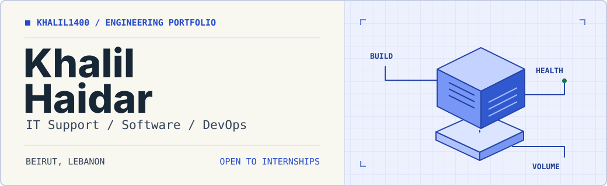

# Khalil Haidar

**From source code to a running service.**

I build full-stack apps and work on what happens after the code is written: how it starts, how you know it's healthy, and whether the data survives a restart. I'm a CS student at Haigazian University in Beirut, **open to DevOps internships**.

[Connect on LinkedIn](https://www.linkedin.com/in/khalil-haidar-8260283b7) · [Browse my repositories](https://github.com/Khalil1400?tab=repositories)

## From Dockerfile to running app

### [Dockerized Student Management App](https://github.com/Khalil1400/website-docker)

One Docker Compose command brings up a Django app for managing students, courses, and grades. The image runs as a **non-root user**, checks that the app responds over HTTP, and keeps SQLite data in a **persistent volume**. There's also a packaged image in Releases.

[Read the setup guide](https://github.com/Khalil1400/website-docker#run-with-docker) · [Inspect the Dockerfile](https://github.com/Khalil1400/website-docker/blob/main/Dockerfile) · [View releases](https://github.com/Khalil1400/website-docker/releases)

## Selected projects

- **[AI Inventory Agent](https://github.com/Khalil1400/AI-Inventory-Agent)** — A Django inventory assistant with local stock commands, pricing and VAT calculations, and a browser chat interface. [See the demo](https://github.com/Khalil1400/AI-Inventory-Agent/blob/main/docs/demo.png).
- **[Tasku](https://github.com/Khalil1400/Tasku)** — A mobile task manager built with Expo, an Express API, Prisma, and PostgreSQL. Includes account sessions, reminders, and attachment support.
- **[Galactic Slimefall](https://github.com/Khalil1400/Galactic-Slimefall-2D-Game-Project)** — A Unity 6 project with turn-based physics, local multiplayer, and bot matches. [See the gameplay showcase](https://github.com/Khalil1400/Galactic-Slimefall-2D-Game-Project#showcase).

## Tools and systems

- **Infrastructure:** Docker, Docker Compose, Linux, Git
- **Software:** Python, Django, JavaScript, Express, React Native
- **Data:** SQL, SQLite, PostgreSQL, Prisma
